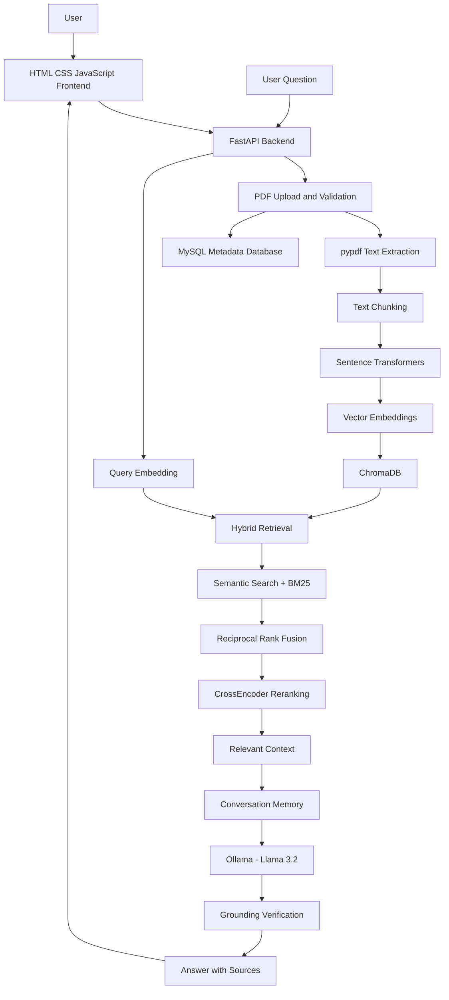

# Enterprise RAG Application

An AI-powered Enterprise Retrieval-Augmented Generation (RAG) application that allows users to upload PDF documents, ask questions, and receive contextual answers based on the uploaded document content.

Built using Python, FastAPI, ChromaDB, Sentence Transformers, BM25, CrossEncoder and Ollama.

---

## 1. Project Overview

The Enterprise RAG Application is designed to retrieve relevant information from uploaded PDF documents and generate accurate, context-aware answers using a Large Language Model (LLM).

Instead of relying only on the LLM's pretrained knowledge, the application retrieves relevant document content and uses it as context for answer generation.

The application supports multiple PDF documents, document selection, hybrid retrieval, reranking, conversational memory, and grounding verification.

## 2. Key Features

- **PDF Document Upload:** Upload and process PDF documents.
- **Text Extraction:** Extract text from PDFs using pypdf.
- **Text Chunking:** Split extracted content into smaller overlapping chunks.
- **Embedding Generation:** Generate vector embeddings using Sentence Transformers.
- **Vector Storage:** Store document embeddings in ChromaDB.
- **Hybrid Search:** Combine semantic search and BM25 keyword search.
- **Reciprocal Rank Fusion:** Combine results from different retrieval methods.
- **Reranking:** Improve retrieval relevance using a CrossEncoder model.
- **LLM Integration:** Generate contextual answers using Ollama and Llama 3.2.
- **Conversational Memory:** Support follow-up questions using session-based conversation history.
- **Grounding Verification:** Verify generated answers against retrieved document context.
- **Source References:** Return relevant document chunks as answer sources.
- **Document Management:** Upload, select, list and delete documents.
- **Metadata Management:** Store document information using MySQL and SQLAlchemy.

## 3. System Architecture

The application follows a modular RAG architecture.

### Architecture Diagram



### RAG Workflow

**Step 1: Document Ingestion**

The user uploads a PDF document through the frontend. FastAPI validates the file and processes it using pypdf.

**Step 2: Text Extraction**

Text is extracted from the PDF pages.

**Step 3: Text Chunking**

The extracted text is divided into smaller chunks with overlapping content to preserve context.

**Step 4: Embedding Generation**

Sentence Transformers converts each text chunk into a numerical vector representation.

**Step 5: Vector Storage**

The embeddings and document metadata are stored in ChromaDB. Document information and chunk records are maintained in MySQL.

**Step 6: Query Processing**

When a user asks a question, the application generates an embedding for the question.

**Step 7: Hybrid Retrieval**

The application combines:
- Semantic search using ChromaDB.
- Keyword search using BM25.

**Step 8: Reciprocal Rank Fusion**

RRF combines the ranked results from semantic and keyword retrieval.

**Step 9: Reranking**

A CrossEncoder reranks retrieved chunks based on their relevance to the user's question.

**Step 10: Answer Generation**

Relevant context is passed to Ollama using the Llama 3.2 model to generate a contextual answer.

**Step 11: Grounding Verification**

The generated answer is checked against the retrieved document context to reduce unsupported responses.

**Step 12: Response Generation**

The application returns the answer along with relevant source references to the frontend.

## 4. Technology Stack

| Component | Technology |
|---|---|
| Programming Language | Python |
| Backend Framework | FastAPI |
| Frontend | HTML, CSS, JavaScript |
| Database | MySQL |
| ORM | SQLAlchemy |
| PDF Processing | pypdf |
| Text Chunking | LangChain Text Splitters |
| Embedding Model | all-MiniLM-L6-v2 |
| Vector Database | ChromaDB |
| Keyword Retrieval | BM25 |
| Ranking Algorithm | Reciprocal Rank Fusion |
| Reranking Model | CrossEncoder |
| LLM | Llama 3.2 (3B) |
| LLM Runtime | Ollama |

## 5. Project Structure

```text
enterprise-rag/
│
├── backend/
│   ├── app/
│   │   ├── main.py
│   │   ├── database.py
│   │   ├── models.py
│   │   ├── document_loader.py
│   │   ├── text_chunker.py
│   │   ├── embeddings.py
│   │   ├── vector_store.py
│   │   ├── retriever.py
│   │   ├── reranker.py
│   │   ├── guardrails.py
│   │   ├── conversation_memory.py
│   │   └── rag.py
│   │
│   └── tests/
│       └── test_pipeline.py
│
├── frontend/
│   ├── index.html
│   ├── style.css
│   └── script.js
│
├── uploads/
├── chroma_db/
├── venv/
├── .env
├── .gitignore
├── requirements.txt
└── README.md
```

## 6. Installation and Setup

### Prerequisites

Install the following before running the application:

- Python 3.10 or later (use a version compatible with your installed dependencies).
- MySQL Server.
- Ollama.
- Git.

### Step 1: Clone the Repository

```bash
git clone https://github.com/KarunakarkReddy/enterprise-rag.git

cd enterprise-rag
```

### Step 2: Create a Virtual Environment

```bash
python -m venv venv
```

Activate it on Windows:

```powershell
.\venv\Scripts\activate
```

### Step 3: Install Dependencies

```bash
pip install -r requirements.txt
```

### Step 4: Configure MySQL

Start MySQL and create the database:

```sql
CREATE DATABASE enterprise_rag;
```

### Step 5: Configure Environment Variables

Create a `.env` file in the project root.

```env
DB_USER=root
DB_PASSWORD=your_mysql_password
DB_HOST=localhost
DB_PORT=3306
DB_NAME=enterprise_rag
```

Replace `your_mysql_password` with your local MySQL password.

**Important:** Never commit your `.env` file to GitHub.

### Step 6: Install Ollama and Download the Model

Install Ollama from:

https://ollama.com/

Download the Llama 3.2 model:

```bash
ollama pull llama3.2:3b
```

Verify that the model is available:

```bash
ollama list
```

Make sure the Ollama service is running before starting the application.

### Step 7: Run the Application

From the project root, activate your virtual environment and execute:

```bash
uvicorn backend.app.main:app --reload
```

### Step 8: Open the Application

Open your browser:

http://127.0.0.1:8000

The FastAPI backend serves the frontend application.

## 7. How to Use

1. Start the application.
2. Open the application in your browser.
3. Upload a PDF document.
4. Wait for the document to be processed and indexed.
5. Select the uploaded document.
6. Enter a question related to the PDF.
7. Receive a contextual answer with source references.
8. Ask follow-up questions using the same conversation session.
9. Upload additional PDFs and select the document you want to query.
10. Delete documents when they are no longer required.

## 8. Retrieval Strategy

This project uses hybrid retrieval to improve the relevance of retrieved document chunks.

### Semantic Search

Uses Sentence Transformers to generate embeddings and ChromaDB to retrieve semantically similar content.

### BM25 Keyword Search

Uses keyword matching to retrieve documents containing relevant terms.

### Reciprocal Rank Fusion

Combines semantic and keyword search rankings into a unified ranking.

### CrossEncoder Reranking

Evaluates the relevance between the user's question and retrieved chunks, improving the final context selection.

## 9. Grounding Verification

The application includes a grounding verification layer to check whether generated answers are supported by retrieved document context.

It helps identify unsupported claims and reduces the likelihood of hallucinated answers.

The verifier uses Ollama with structured verdicts and deterministic settings where supported.

Grounding verification is a safeguard, not a guarantee that every answer is factually correct.

## 10. Limitations

- Scanned PDFs and image-only PDFs require OCR, which is not currently included.
- Answer quality depends on PDF text quality, retrieval relevance and the selected LLM.
- Large documents may require additional processing time.
- Conversation history is session-based and stored in application memory; it does not persist across backend restarts.
- The application currently runs locally and does not include a production cloud deployment.

## 11. Future Improvements

- Add OCR support for scanned PDFs.
- Implement persistent conversation storage.
- Add authentication and role-based access control.
- Improve retrieval evaluation using a benchmark dataset.
- Add support for additional document formats.
- Deploy the application to a cloud environment.
- Add document-level access permissions.

## 12. Learning Outcomes

Through this project, I gained practical experience in:

- Building an end-to-end Retrieval-Augmented Generation system.
- Working with vector databases and embedding models.
- Implementing hybrid information retrieval.
- Understanding BM25 and Reciprocal Rank Fusion.
- Improving retrieval using CrossEncoder reranking.
- Integrating locally hosted LLMs.
- Building REST APIs using FastAPI.
- Managing relational data using MySQL and SQLAlchemy.
- Implementing conversational context and answer grounding.

## 13. Author

**Enterprise RAG Application**

Developed as a Generative AI engineering project to explore document-based question answering, hybrid retrieval and LLM-powered applications.

---

**If you find this project useful, consider giving the repository a star!**


